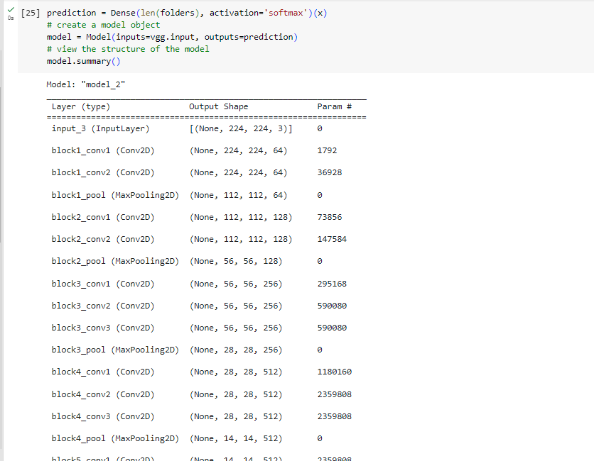
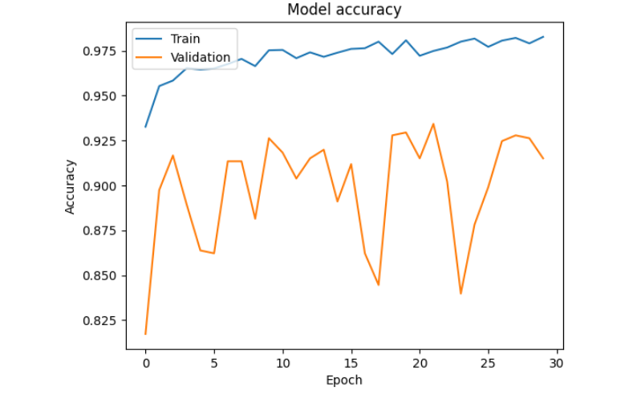
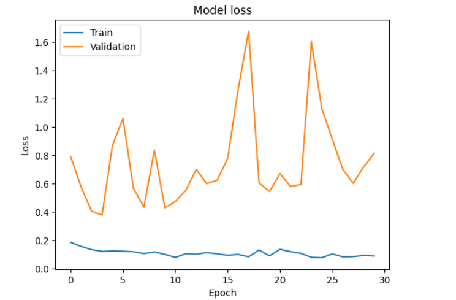
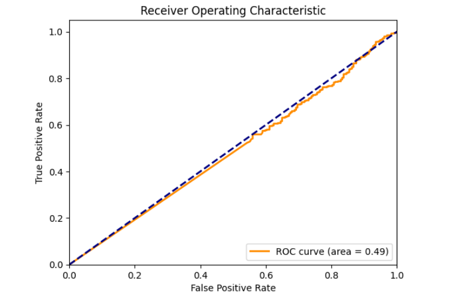

# A Hybrid VGG16-Based Deep Learning System for Automated Pneumonia Detection from Pediatric Chest X-Ray Images

Code for the paper accepted at **ADMIT 2026** (paper ID A020).

**Authors:** Umair Tariq, Abdel-Rahman H. Tawil (Birmingham City University), Abdallah Tubaishat (Zayed University), Jiaming Ke (Wuhan Textile University)

> **Important: exploratory version.** The notebooks in this repository are an **earlier exploratory version** of the experiments (2024). They do **not** reproduce the final results reported in the paper (87.02% image-only VGG16 accuracy, and 95.03% preliminary accuracy for the VGG16 + symptom-fusion model), and they do not contain the symptom-fusion model. The final, verified training code will be added to this repository.



## Overview

The system classifies pediatric chest X-rays as **Normal** or **Pneumonia** using VGG16 transfer learning:

- VGG16 pretrained on ImageNet, with all convolutional layers frozen
- A flattened feature vector followed by a 2-way softmax classification layer (50,178 trainable parameters)
- Input size 224 × 224, with rescaling, shear, zoom and horizontal-flip augmentation

The paper also describes a dual-branch extension that fuses image features with structured symptom data. That model is **not** included in this exploratory version.

## Dataset

[Chest X-Ray Images (Pneumonia)](https://www.kaggle.com/datasets/paultimothymooney/chest-xray-pneumonia) (Kermany et al.): pediatric chest X-rays labelled Normal / Pneumonia, with the standard 624-image test set (234 Normal, 390 Pneumonia).

The dataset is not redistributed here. Download it and arrange it as:

```
chest_xray/
├── train/{NORMAL,PNEUMONIA}/
├── val/{NORMAL,PNEUMONIA}/
└── test/{NORMAL,PNEUMONIA}/
```

## Repository structure

```
├── notebooks/
│   ├── pneumonia_vgg16_30epochs.ipynb   # 30-epoch training, accuracy/loss curves, ROC, confusion matrix
│   └── pneumonia_vgg16_1epoch.ipynb     # 1-epoch training, predictions, classification report
├── figures/                             # Result screenshots from the exploratory runs
└── requirements.txt
```

## Usage

The notebooks were written for **Google Colab** with the dataset on Google Drive (GPU runtime recommended).

1. Upload the dataset to your Google Drive.
2. Open a notebook in Colab.
3. Update the dataset paths (`/content/drive/MyDrive/chest_xray/...`) to match your Drive.
4. Run all cells.

To run locally, remove the `google.colab` drive-mount cell, change the paths, and install the dependencies:

```bash
pip install -r requirements.txt
```

## Exploratory results

These are the outputs recorded in the notebooks. They are **not** the paper's results.

| Run | Training images | Batch size | Epochs | Validation accuracy (624 test images) |
|---|---|---|---|---|
| `pneumonia_vgg16_1epoch` | 5,216 | 10 | 1 | 91.19% |
| `pneumonia_vgg16_30epochs` | 5,216 | 10 | 30 | 91.51% |

Both runs use Adam with Keras default settings.

Notes:
- The classification report inside `pneumonia_vgg16_1epoch.ipynb` shows about 50% accuracy. This is an evaluation artefact: the test generator shuffles images by default, so the predictions are misaligned with `test_set.classes`. It does not reflect the model's real performance.
- `figures/classification_report_878_images.png` comes from a separate evaluation on 878 images that is not part of these notebooks.

| Accuracy | Loss | ROC |
|---|---|---|
|  |  |  |

## Citation

```bibtex
@inproceedings{tariq2026hybridvgg16,
  title     = {A Hybrid VGG16-Based Deep Learning System for Automated Pneumonia Detection from Pediatric Chest X-Ray Images},
  author    = {Tariq, Umair and Tawil, Abdel-Rahman H. and Tubaishat, Abdallah and Ke, Jiaming},
  booktitle = {Proceedings of ADMIT 2026},
  year      = {2026}
}
```

## License

All rights reserved. A license will be added on publication.
